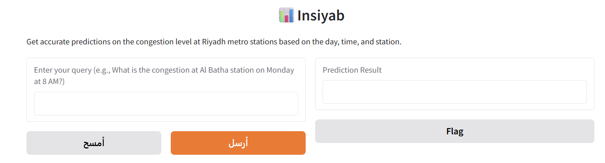
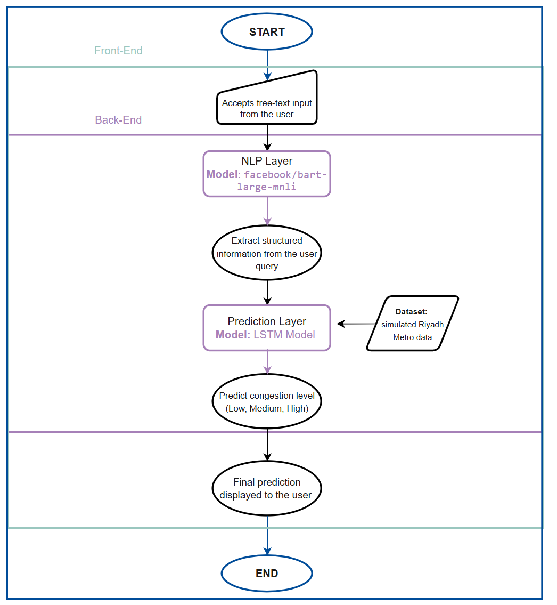

<div align="center">


# Insiyab · إنسياب
### AI-Powered Congestion Prediction for Riyadh Metro
### التنبؤ بالازدحام في مترو الرياض بالذكاء الاصطناعي


👥 **Team project** · Course: AI Application Programming (CAI 360) · Princess Nourah bint Abdulrahman University · 2025

👥 **مشروع جماعي** · المقرر: برمجة تطبيقات الذكاء الاصطناعي (CAI 360) · جامعة الأميرة نورة بنت عبدالرحمن · 2025

[English](#english) · [العربية](#arabic)

</div>

---

<a id="english"></a>

## Overview

As the Riyadh Metro expands, knowing how crowded a station will be helps commuters plan their trips and helps operators run the network more efficiently.

**Insiyab** lets anyone ask about congestion **in plain language**, for example *"Is Al Batha crowded on Monday at 8 AM?"*, and instantly returns the predicted congestion level (**Low / Medium / High**) with the probability of each level.

It combines two AI components:

- 🧠 **A pre-trained NLP model** (`facebook/bart-large-mnli`, zero-shot classification) that understands the question and extracts the **station**, **day** and **time**, with no extra training and no dropdown menus.
- 📈 **A custom LSTM model** that we trained to predict the congestion level from spatial and temporal features.



## How It Works



1. The user types a free-text question in the **Gradio** web interface.
2. **BART-large-MNLI** matches the question against the list of metro stations and weekdays, and a regular expression extracts the hour (AM/PM to 24-hour format).
3. The extracted features are encoded and passed to the **LSTM** model.
4. The app displays the predicted congestion level with color indicators (🟢 Low · 🟡 Medium · 🔴 High) and the probability of each class.

## Data

No public Riyadh Metro data was available, so we **generated a synthetic dataset of 10,000 trips** that simulates realistic metro operations across 15 stations and multiple colored lines. Each trip includes the route, start and end stations, hour, weekday, distance, travel time, peak-hour flag, passenger demand, speed and the congestion label.

**Preprocessing:** cleaning, label encoding of categorical features, Min-Max scaling of numeric features, and **class balancing** by undersampling (the Medium class was dominant), followed by class weights during training.

## Model

| Setting | Value |
|---|---|
| Architecture | `LSTM(64)` → `Dropout(0.2)` → `Dense(32, ReLU)` → `Dense(3, softmax)` |
| Inputs | 10 features: distance, travel time, passenger demand, speed, hour, peak hour, weekday, route, start and end station |
| Training | Adam · sparse categorical cross-entropy · batch size 16 · early stopping (patience 5) · balanced class weights |
| Split | 80% training / 20% testing |

## Results

| Metric | Best run |
|---|---|
| **Accuracy** | **95%** |
| Macro precision / recall / F1 | 0.95 / 0.95 / 0.95 |
| Test samples | 138 |

Two of the three congestion classes reached **100% recall**, and the NLP layer correctly extracted the station, day and hour from over 90% of natural-language queries.

> Because the balanced training set is small (687 samples after undersampling), results vary between training runs. The run saved in the notebook reached 86% accuracy; the best run, documented in the report, reached 95%.

## Code Improvements

The notebook in this repository is an **improved version** of the code described in the report. Two issues in the app's prediction function were fixed:

- **Class labels:** the app now reads the class order directly from the trained label encoder, so each probability is shown next to the correct congestion level.
- **Feature order:** the weekday is now passed in the same position used during training.

## Repository Structure

```
├── notebooks/
│   └── insiyab_pipeline.ipynb      # data analysis → preprocessing → LSTM → NLP extraction → Gradio app
├── docs/
│   ├── insiyab_report.pdf          # project report
│   └── insiyab_presentation.pdf    # project presentation
├── assets/                         # logo, system flow and interface
├── requirements.txt
└── README.md
```

## How to Run

Open `notebooks/insiyab_pipeline.ipynb` in **Google Colab** (a GPU is recommended for the BART model), upload the synthetic dataset `Riyadh_Metro_Synthetic_10k.csv`, and run all cells. The last cell launches the Gradio app.

## Limitations and Future Work

- Train on **real Riyadh Metro data** when it becomes available
- Add context such as **events, weather and schedule changes**
- Add **speech input**, interactive guidance and a production-grade interface
- Integrate with other transport modes such as **smart buses**

## Team

**Wasan Alomar** · Hessah AlMujally · Manairh Alonizan · Taif Alharbi · Manar Alahmari

Supervised by **Dr. Eman Aljabarti**

📄 [Project report](docs/insiyab_report.pdf) · [Presentation](docs/insiyab_presentation.pdf)

---

<a id="arabic"></a>
<div dir="rtl">

## نظرة عامة

مع توسّع مترو الرياض، أصبحت معرفة مستوى الازدحام في المحطات مسبقاً أمراً مهماً لمساعدة الركاب على تخطيط رحلاتهم، ولرفع كفاءة تشغيل الشبكة.

**إنسياب** يتيح لأي شخص أن يسأل عن الازدحام **بلغة طبيعية**، مثل: *"هل محطة البطحاء مزدحمة يوم الاثنين الساعة 8 صباحاً؟"*، ويعرض فوراً مستوى الازدحام المتوقع (**منخفض / متوسط / مرتفع**) مع نسبة احتمال كل مستوى.

ويجمع النظام بين مكوّنين:

- 🧠 **نموذج معالجة لغة طبيعية مدرّب مسبقاً** (`facebook/bart-large-mnli`) يفهم السؤال ويستخرج **المحطة** و**اليوم** و**الوقت**، دون تدريب إضافي ودون قوائم اختيار.
- 📈 **نموذج LSTM** درّبناه للتنبؤ بمستوى الازدحام بناءً على خصائص المكان والزمان.

## البيانات

لعدم توفر بيانات عامة لمترو الرياض، **أنشأنا مجموعة بيانات محاكاة من 10,000 رحلة** تحاكي التشغيل الفعلي للمترو عبر 15 محطة وعدة مسارات. ثم نظّفناها ورمّزناها ووحّدنا مقاييسها، و**وازنّا بين فئات الازدحام**.

## النتائج

- **دقة 95%** في أفضل تجربة تدريب، و F1 يبلغ 0.95
- استدعاء (Recall) بنسبة **100%** لفئتين من فئات الازدحام الثلاث
- استخراج صحيح للمحطة واليوم والوقت في أكثر من **90%** من الأسئلة

> نظراً لصغر حجم البيانات بعد الموازنة (687 عينة)، تختلف النتائج بين تجارب التدريب. والتجربة المحفوظة في الكود حققت دقة 86%، بينما حققت أفضل تجربة الموثّقة في التقرير دقة 95%.

## تحسينات الكود

الكود في هذا المستودع **نسخة محسّنة** من الكود الموصوف في التقرير، إذ تم تصحيح ترتيب أسماء فئات الازدحام في واجهة التطبيق، وترتيب خاصية اليوم عند التنبؤ لتطابق ترتيب التدريب.

## التقنيات المستخدمة

Python · TensorFlow / Keras · Hugging Face Transformers · Gradio · scikit-learn · Pandas · Seaborn

## الفريق

**Wasan Alomar** · Hessah AlMujally · Manairh Alonizan · Taif Alharbi · Manar Alahmari

بإشراف **Dr. Eman Aljabarti**

📄 [تقرير المشروع](docs/insiyab_report.pdf) · [العرض التقديمي](docs/insiyab_presentation.pdf)

</div>
